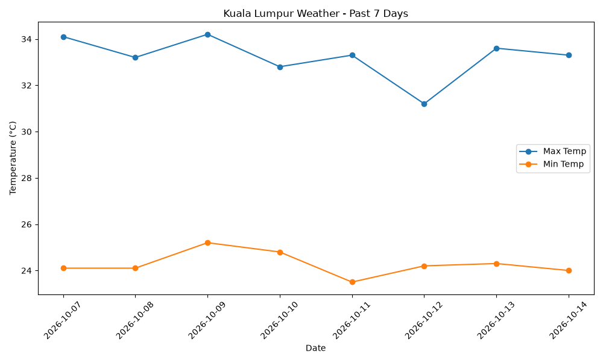

# Kuala Lumpur Weather

My first Python data project. It fetches the past 7 days of temperatures from the Open-Meteo API, saves them to a CSV, and plots a chart.

## What I learned
- Calling an API with requests
- Organizing data with pandas
- Plotting with matplotlib

## How to run
pip install requests pandas matplotlib
python get_data_KL.py

## Result

